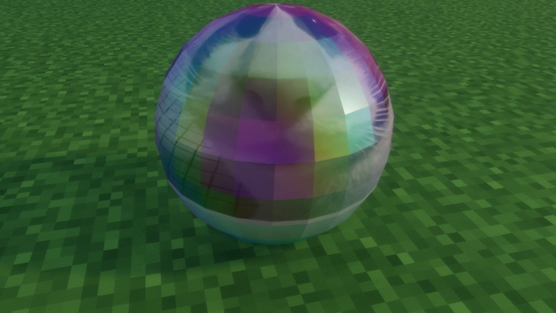

# Suspicious Speculars — download host

*Shape: [ArchitectureCraft: Renovated](https://github.com/NeoRussia/ArchitectureCraft-Renovated). The prismatic film over it is the shader's.*

This repository holds the two resource packs that the Suspicious Speculars patcher
(`suspicious-speculars`) fetches into a player's `resourcepacks/` folder. It is a
download location, not the mod's source.

| File | Size |
|---|---|
| `packs/Suspicious Speculars.zip` | 1.84 MB |
| `packs/Suspicious Speculars - Eclipse Addon.zip` | 0.14 MB |

The SHA-256 of each archive is in [`packs.txt`](packs.txt) — the manifest the installer downloads
and verifies against — so the hashes live in exactly one place and cannot drift from the files. A
copy of that manifest also travels inside the mod jar, for the run that cannot reach this host.

The installer fetches the two paths from that manifest and verifies every download against its hash
before enabling it. A file whose bytes change must come with an updated `packs.txt`, or the download
is rejected and deleted.

They are fetched as raw files from the `main` branch:

    https://raw.githubusercontent.com/NeoRussia/suspicious-speculars/main/packs/<name>

Do not move them out of `packs/`, rename them, or store them with Git LFS — LFS serves
a pointer instead of the archive and every download would fail its hash check.

## What the two packs are

- **Suspicious Speculars** — the labPBR material pack: smoothness and F0 maps plus the
  derived emissive layers. Works with any labPBR-capable shader.
- **Suspicious Speculars - Eclipse Addon** — marker maps that only the patched Eclipse
  build reads. Stock Eclipse misreads them as subsurface scattering, so this pack is
  only enabled together with the patched shader.

They are disjoint: every texture is in exactly one of them, so load order does not matter.

## Credits

The packs contain **no base textures** from any other project: 5,613 smoothness/F0/emission
maps (`_s`), 6 normal maps (`_n`) and 60 derived emissive layers with their `.mcmeta`
files. Every one is a companion map or a derived layer.

**Base art the maps are derived from**, by namespace:

| Source | Files | What the maps describe |
|---|---|---|
| [GregTech CEu](https://github.com/GregTechCEu/GregTech) 1.12.2-2.8.10-beta | 2,204 | material families, casings, pipes, machine overlays |
| [Chisel](https://github.com/Chisel-Team/Chisel) 1.12.2-1.0.2.45 | 3,425 | decorative blocks: concrete, glass, metals, ice, wool, lamps |
| [Xtones](https://github.com/TehKrush/Xtones) (via SuperSymmetry) | 7 | Lave faces |
| [ProjectRed](https://github.com/MrTJP/ProjectRed) | 20 | lamps, illuminated blocks |
| [Applied Energistics 2](https://github.com/AppliedEnergistics/Applied-Energistics-2) | 19 | cable and machine casings |
| [Pyrotech](https://github.com/codetaylor/pyrotech) | 6 | refractory blocks |
| [Serene Seasons](https://github.com/TheAdubbz/SereneSeasons) | 6 | season tint layers |
| [Biomes O' Plenty](https://github.com/Glitchfiend/BiomesOPlenty) | 2 | stone types |
| [SuperSymmetry](https://github.com/SymmetricDevs/Supersymmetry) pack + [Susy-Core](https://github.com/SymmetricDevs/Susy-Core) | 2 | the pack's own blocks |
| Minecraft 1.12.2 (Mojang) | 17 | vanilla blocks |

**Map data reused from other PBR packs**

- **KuramA-777**, *Kura Reflections GTNH* V1.4.0 (`KuraReflectionsGTNH-V1.4.0.zip`, commit
  `61984f5`, repo `KuramA-777/GTNH-2.9.X-Shader-Edits-and-PBR-Packs`): the Xtones Lave 9/13
  and the Chisel laboratory / parquet / tyrian `_s` and `_n` maps.
- **Egregious Emissives** (LGPL-3.0-only): labPBR `_s` emission for GregTech CEu, regenerated
  for 2.8.10 and for SuperSymmetry's own blocks.

**Derived here, not copied.** The `overlay_*_active_emissive` layers come from
`tools/derive-active-emissive.ps1`: every emitted pixel is a pixel of GregTech's own active
sprite above a luminance threshold, so no new art is invented. The same script family,
`tools/gen-gt-specular.ps1`, `gen-chisel-specular.ps1` and `gen-susy-specular.ps1`, generates
every tiered map from the material rules in `tools/pbr-tiers.ps1`. The scene profiles and
`block.properties` id maps derive from KuramA's Eclipse profile and SuperSymmetry's config.

**Not included.** The Eclipse shader is fetched separately and is all rights reserved
(Chocapic13), as is Chroma Patch (OBS07) — no Chroma Patch data is used here.

**Licence.** This repository's code and configuration are LGPL-3.0, inherited from
SuperSymmetry (`LICENSE`); contributions follow SuperSymmetry's AI usage policy
(`AI_POLICY.md`). Redistributing a *derived* map also depends on the terms of the pack it was
derived from: Egregious Emissives is LGPL-3.0-only and compatible, GregTech CEu is LGPL-3.0,
while Chisel, Xtones, ProjectRed, Pyrotech, Serene Seasons and Biomes O' Plenty each carry
their own terms and KuramA's repository publishes no licence file I could find. Those are the
ones to clear with their authors before this repository is made public.

